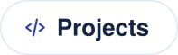

<p align="center">
  
</p>

<p align="center">
  
</p>

<p align="center">
  
</p>

<p align="center">
  <a href="https://engrgab.dev"></a>
  <a href="https://www.linkedin.com/in/gabriel-andrei-villanueva-56494337a/"></a>
  <a href="mailto:cpe.villanueva.gabrielandrei@gmail.com"></a>
  <a href="https://github.com/gabbygab18?tab=repositories"></a>
</p>

<p align="center">
  
  
  
</p>


<p align="center"></p>

<h2 align="center">
  
</h2>

<p align="center">
<b>Full stack development with a designer's eye.</b><br/>
<i>Web developer and designer in San Pablo City, Laguna, PH. I build websites, web apps,<br/>
online stores, dashboards and brands for businesses, designed, built and launched end to end.</i>
</p>

```js
const gabbygab = {
  name:      "Gabriel Andrei Villanueva",
  role:      "Web Developer & Designer",
  location:  "San Pablo City, Laguna, PH",
  education: "BS Computer Engineering, Pamantasan ng Lungsod ng San Pablo (2022-2026)",
  currently: "Isla Outsourcing Solutions",
  frontend:  ["react", "next.js", "vue", "angular", "typescript", "tailwind", "gsap", "three.js"],
  backend:   ["php", "laravel", "node.js", "express", "mysql", "postgresql", "mongodb"],
  baas:      ["supabase", "firebase", "cloudinary"],
  devops:    ["linux", "docker", "github actions", "vercel", "aws", "cloudflare"],
  design:    ["figma", "photoshop", "premiere pro", "canva"],
  services:  ["web & app development", "ui/ux & graphic design", "brand identity",
              "automation & internal tools", "seo & search visibility"],
  portfolio: "https://engrgab.dev"
};
```

<p align="center">
  
</p>


<p align="center"></p>

<h2 align="center">
  
</h2>
<p align="center">
  
</p>

<p align="center">
  
</p>
<p align="center">
  
</p>

<p align="center">
  
</p>
<p align="center">
  
</p>

<p align="center">
  
</p>
<p align="center">
  
</p>

<p align="center">
  
</p>
<p align="center">
  
</p>

<p align="center">
  
</p>
<p align="center">
  
</p>


<p align="center"></p>

<h2 align="center">
  
</h2>

<div align="center">

<table>
  <tr>
    <td valign="top" width="50%"><a href="https://engrgab.dev/projects/glint-ui"><b>Glint UI</b></a><br/><sub>React &middot; shipped 2026 &middot; live</sub><br/><br/>A library of 354 animated React components, installable through the shadcn CLI.</td>
    <td valign="top" width="50%"><a href="https://engrgab.dev/projects/orbit"><b>Orbit</b></a><br/><sub>Electron &middot; shipped 2026</sub><br/><br/>An always-on-top desktop widget that shows what Claude Code is doing.</td>
  </tr>
  <tr>
    <td valign="top"><a href="https://engrgab.dev/projects/pulse"><b>Pulse</b></a><br/><sub>Electron &middot; shipped 2026</sub><br/><br/>A desktop time-tracking widget for Isla Outsourcing staff.</td>
    <td valign="top"><a href="https://engrgab.dev/projects/sahara-stocks"><b>Sahara Stocks</b></a><br/><sub>Laravel &middot; in progress</sub><br/><br/>An inventory system for Sahara Construction Supply.</td>
  </tr>
  <tr>
    <td valign="top"><a href="https://engrgab.dev/projects/sampay"><b>Sampay</b></a><br/><sub>Next.js &middot; in progress</sub><br/><br/>A secondhand clothing marketplace with an AI stylist.</td>
    <td valign="top"><a href="https://engrgab.dev/projects/avatar-lab"><b>Avatar Lab</b></a><br/><sub>Next.js &middot; in progress</sub><br/><br/>A studio for procedural 2D characters.</td>
  </tr>
</table>

<a href="https://engrgab.dev/projects/avatar-lab"></a><br/>
<sub>the cast, drawn by <a href="https://engrgab.dev/projects/avatar-lab">Avatar Lab</a></sub>
<br/><br/>

<a href="https://engrgab.dev/work"></a>

</div>


<p align="center"></p>

<h2 align="center">
  
</h2>

<div align="center">

<details>
<summary><b>6 Roles Since 2022</b></summary>
<br/>

<table>
  <tr>
    <td valign="top" align="right" nowrap><b>2026 &ndash; Present</b></td>
    <td valign="top"><b>Full Stack Developer | Social Media Marketing Officer</b><br/><sub>Isla Outsourcing Solutions</sub><br/><br/>Build and maintain the company's client and staff portals and core web platform across the full stack, while managing social content and campaigns that support brand visibility and lead generation.</td>
  </tr>
  <tr>
    <td valign="top" align="right" nowrap><b>2026</b></td>
    <td valign="top"><b>Full Stack Developer</b><br/><sub>Monte Carlo Technologies</sub><br/><br/>Developed and maintained web application features across the full stack, contributing clean, scalable code in a fast-paced, collaborative environment.</td>
  </tr>
  <tr>
    <td valign="top" align="right" nowrap><b>2025 &ndash; Present</b></td>
    <td valign="top"><b>Graphic Designer</b><br/><sub>Sweet Ghen</sub><br/><br/>Created sticker designs and branding materials for a range of food products &mdash; chips, pastillas and sampaloc candies &mdash; keeping one visual identity across the product line.</td>
  </tr>
  <tr>
    <td valign="top" align="right" nowrap><b>2025</b></td>
    <td valign="top"><b>Freelance Full Stack Developer</b><br/><sub>Self Employed</sub><br/><br/>Designed and built custom web applications for clients, translating requirements into responsive interfaces with clean backend logic following MVC and RESTful API principles. Ran the full project lifecycle solo, then deployed and maintained the work on cPanel hosting and live domains.</td>
  </tr>
  <tr>
    <td valign="top" align="right" nowrap><b>2022</b></td>
    <td valign="top"><b>Social Media Manager</b><br/><sub>Hayde Perfume</sub><br/><br/>Planned and executed content strategies, created on-brand visuals, and managed community engagement to grow Hayde Perfume's presence across social platforms.</td>
  </tr>
  <tr>
    <td valign="top" align="right" nowrap><b>2022</b></td>
    <td valign="top"><b>Freelance Graphic Designer</b><br/><sub>Self Employed</sub><br/><br/>Designed brand identities, logos and visual materials for clients across several industries, delivering purposeful creative work from concept to final output.</td>
  </tr>
</table>

</details>

</div>


<p align="center"></p>

<h2 align="center">
  
</h2>

<p align="center">
  
</p>

<p align="center">
  
</p>

<p align="center">
  
</p>


<p align="center"></p>

<h2 align="center">
  
</h2>

<p align="center">
  <picture>
    <source media="(prefers-color-scheme: dark)" srcset="https://raw.githubusercontent.com/gabbygab18/gabbygab18/output/github-snake-dark.svg" />
    <source media="(prefers-color-scheme: light)" srcset="https://raw.githubusercontent.com/gabbygab18/gabbygab18/output/github-snake.svg" />
    
  </picture>
</p>


<p align="center"></p>

<h2 align="center">
  
</h2>

<p align="center">
  <a href="https://engrgab.dev/projects/avatar-lab"></a>
</p>

<h3 align="center">Have something to build?</h3>

<p align="center">
<b>Web &amp; app development</b> &middot; <b>UI/UX &amp; graphic design</b> &middot; <b>brand identity</b><br/>
<b>automation &amp; internal tools</b> &middot; <b>SEO &amp; search visibility</b>
</p>

<p align="center">
free consultation, reply within 24 hours.
</p>

<p align="center">
  <a href="https://engrgab.dev/contact"></a>
  <a href="https://engrgab.dev/services"></a>
</p>

<p align="center">
  
</p>

<p align="center">
  
</p>
# gabbygab18
